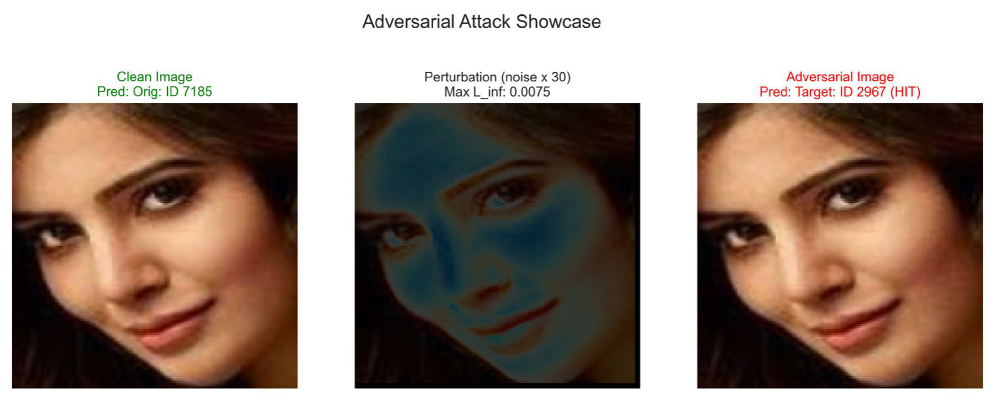
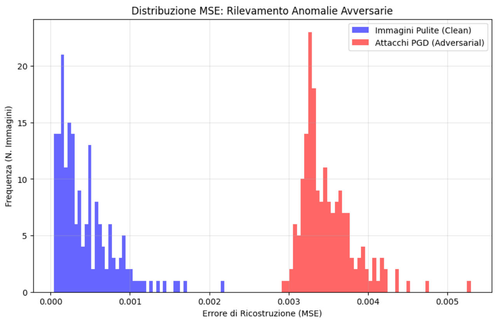

# Adversarial Attacks & Defenses on Face Recognition

**AI for Cybersecurity — University of Salerno (DIEM), A.Y. 2025/2026 — Group 16, Track 1**

How hard is it to fool a face recognition network with noise a human can't see, and how much can you do about it without retraining the model?

This project attacks an **InceptionResnetV1** face classifier (VGGFace2, 8631 identities) with five evasion attacks, tests whether those attacks transfer to a different, unseen network (**SENet50**), and evaluates three defenses that sit in front of the model: a classic preprocessing pipeline, a denoising autoencoder, and an autoencoder-based anomaly detector.

<p align="center">
  
  <br><em>Carlini & Wagner targeted attack at L∞ = 0.0075: the two faces look identical, the network sees a different person.</em>
</p>

---

## Highlights

| | |
|---|---|
| **Test set** | 1000 images, 100 VGGFace2 identities × 10, MTCNN face crops at 160×160 |
| **Threat model** | White-box on the source model, black-box via transferability; L∞ budget ε ≤ 0.1 (stress-tested up to 0.2) |
| **Attacks** | FGSM, BIM, PGD, DeepFool, Carlini & Wagner L∞, untargeted and targeted (Next-Best, Random, Least-Likely, Round-Robin subsets) |
| **Source / target models** | InceptionResnetV1 (NN1, `facenet-pytorch`) → SENet50-ft (NN2, Caffe preprocessing, 224×224) |
| **Defenses** | Smoothing + JPEG pipeline, Denoising Autoencoder, MSE-based Anomaly Detector |
| **Custom C&W** | PyTorch re-implementation of ART's `CarliniLInfMethod`, numerically matched to ART, **~15× faster** (751 s → 50 s), plus a fix for ART's targeted success check |

## Results at a glance

### White-box: every attack breaks the model

Untargeted (error-generic), on NN1:

| Attack | ε | Robust accuracy |
|---|---|---|
| FGSM | 0.050 | 0.11% |
| BIM | 0.100 | 0.00% |
| PGD | 0.015 | 0.00% |
| DeepFool | 0.100 | 0.11% |
| **Carlini & Wagner** | **0.0126** | **0.00%** |

Targeted (error-specific), targeted attack success rate:

| Attack | Next-Best | Random | Least-Likely |
|---|---|---|---|
| FGSM (ε = 0.025) | 97.0% | 19.7% | 0.0% |
| BIM | 100% (ε = 0.025) | 100% (ε = 0.025) | 100% (ε = 0.05) |
| PGD | 100% (ε = 0.010) | 100% (ε = 0.040) | 99.8% (ε = 0.040) |
| Carlini & Wagner | 100% (ε ≈ 0.023) | – | – |

Single-step FGSM can push a face out of its class but can't steer it to a distant target: the perturbation lands in some third identity along the way. Iterative attacks can impersonate essentially anyone.

### Black-box: the sharpest attacks transfer the worst

Same adversarial images, fed to SENet50 (upscaled 160→224, Caffe normalization):

| Attack | ε | NN1 robust acc. | NN2 robust acc. |
|---|---|---|---|
| FGSM | 0.100 | 0.3% | 3.0% |
| BIM | 0.100 | 0.0% | 45.8% |
| PGD | 0.020 | 0.0% | 39.8% |
| DeepFool | 0.100 | 0.1% | 98.8% |
| C&W | ≈ 0.0136 | 0.0% | 98.0% |

DeepFool and C&W stop exactly at NN1's decision boundary, so a bilinear upscale is enough to undo them. FGSM and PGD (random restarts, flatter minima) carry over much better. Targeted attacks almost never transfer, but they often still destroy the original identity on NN2.

### Defenses

- **Preprocessing (Spatial Smoothing 7×7 + JPEG q=70)**, picked via a 3D grid search over smoothing / feature squeezing / JPEG. Strong against low-energy attacks: DeepFool and C&W untargeted go from ~0% back to ~90% robust accuracy. Weak against high-ε gradient attacks.
- **Denoising Autoencoder** (3-layer conv encoder/decoder, trained 100 epochs on clean 32-bit TIFF faces). Better at preserving identity semantics; DeepFool recovers to ~96%.
- **Anomaly Detector**: the same autoencoder used as a gatekeeper. Clean and adversarial images form two clearly separated reconstruction-error distributions, and with a threshold at 5% FPR it **blocks 100% of FGSM and targeted BIM inputs from ε ≥ 0.05–0.075**. Low-ε PGD, DeepFool and C&W mostly slip through.

The defenses complement each other: the preprocessing/denoiser handles the subtle attacks (DeepFool, C&W), while the detector catches the loud ones (FGSM, targeted BIM).

<p align="center">
  
</p>

## Engineering notes

A few things that weren't in the original plan:

- **JPEG kills the attack.** Saving adversarial images as JPG wiped out the perturbation, PNG quantization skewed the L∞ check at small ε. The whole I/O pipeline uses **32-bit floating-point TIFF**.
- **C&W in double precision.** At budgets around 10⁻³, float32 gradients were too coarse, so the model runs in float64 behind an `ARTFloat64Wrapper`, with a batched binary search and an in-place Adam optimizer that avoids CPU–GPU syncs.
- **Cross-resolution transfer.** Four alternatives to bilinear upscaling (padding, VAE upscaling, perturbation-only resize, generating at 224 on NN1) were tested and discarded; each one either broke the clean baseline or acted as an accidental defense.
- **Experiment logger.** Every batch logs its results (attack, strategy, ε, defense, robust accuracy, t-ASR, u-ASR) to a shared Google Sheet via `gspread`.

## Repository structure

```
├── AI_for_Cybersecurity_Report_Gruppo16.pdf   # full report (Italian, 64 pages)
├── clean/                                     # test set: 100 identities × 10 images + splits/
│   ├── splits/                                # manifest, identity mapping, round-robin subsets
│   └── test/
└── src/
    ├── 1_Dataset_Creation/          # VGGFace2 subset sampling (notebook)
    ├── 2_NN1_Clean_Evaluation/      # MTCNN crop + InceptionResnetV1 baseline
    ├── 3_Adversarial_Examples/      # attacks on NN1
    │   └── AttackEvaluation/
    │       ├── error_generic/       # fgsm, bim, pgd, deepfool, cw: scouting → generation → metrics/plots
    │       └── error_specific/      # fgsm, bim, pgd, cw (targeted)
    ├── 4_NN2_Clean_Evaluation/      # SENet50 baseline
    ├── 5_NN2_Adversarial_Examples/  # transferability NN1 → NN2
    ├── 6_Defence_Mechanisms/
    │   ├── preprocessing/           # filter scouting, 3D grid search, final pipeline
    │   └── anomaly_detection/       # autoencoder training, denoiser and detector evaluation
    ├── models/                      # SENet50 / ResNet definitions and weights
    └── util/                        # shared attack utils, metrics, C&W benchmarks vs ART
```

Most attack folders follow the same three steps: `scouting_hyper_params` → `samples_gen` → `metrics_and_plots`.

## Getting started

```bash
pip install torch torchvision facenet-pytorch adversarial-robustness-toolbox torchattacks \
            opencv-python pillow numpy pandas matplotlib seaborn tqdm scikit-learn umap-learn \
            grad-cam gspread
```

1. Unzip `dataset_clean.zip` (or use `clean/` directly).
2. Run `src/2_NN1_Clean_Evaluation/nn1_clean_evaluation.py` to build the clean-verified baseline.
3. Pick an attack under `src/3_Adversarial_Examples/AttackEvaluation/` and run its scripts in order.
4. Run `src/5_NN2_Adversarial_Examples/5_transferability_test.py` for the black-box evaluation.
5. Defenses live in `src/6_Defence_Mechanisms/`.

Experiments were run on an NVIDIA RTX 5070 Ti. The Google Sheets logger needs your own service-account credentials.

## Team

- Leonardo Luongo
- Francesco Monda
- Andrea Pulzone

The full methodology, every security evaluation curve, UMAP trajectories and per-heuristic analysis are in the [report](AI_for_Cybersecurity_Report_Gruppo16.pdf) (in Italian).
